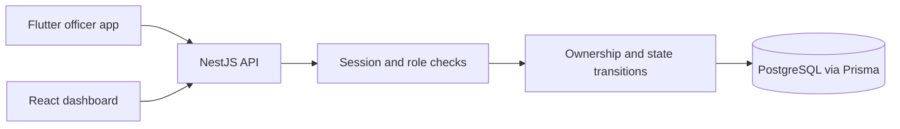

# Architecture

Flutter (Android) and React/Vite call the NestJS REST API at `/api/v1`. NestJS validates DTOs, resolves the server-managed session and enforces role and object permissions. Prisma persists data in local PostgreSQL. Swagger serves request contracts at `/api/docs`.

The stored entities in this slice are User, OfficerProfile, Session, Driver, Vehicle, OffenceCategory, Offence, Ticket and AuditEvent. Offence owns the reviewer assignment; Ticket has a unique offence foreign key and random 192-bit public reference. The random reference alone does not expose any public route.

All authoritative creation/issuance/review timestamps come from the backend/database. Officers supply an ISO observation timestamp with a timezone, subject to a future-time check, and may optionally provide paired coordinates through the API. Mobile currently uses manual location only.

Additional entities now include Incident, Checkpoint, SystemSetting, TrafficAlert, Evidence, PublicTicketAccess and PublicTicketSession. Private images live in `.storage/evidence`, behind ownership-checked routes. Public ticket verification uses a separate hashed code and a separate session table; staff session validation cannot accept a public token. Public road reports carry PUBLIC_UNVERIFIED and no reporter identity. No GPS streams or public driver records are collected.
